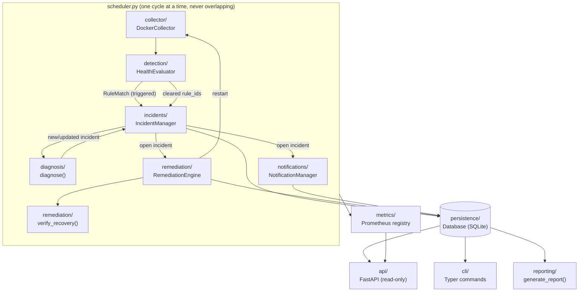
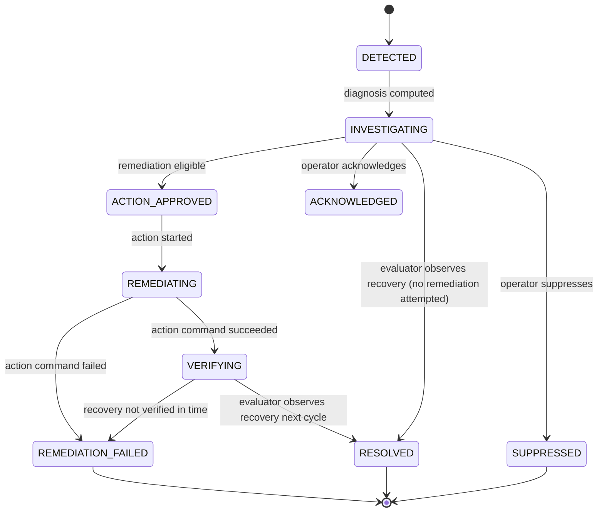
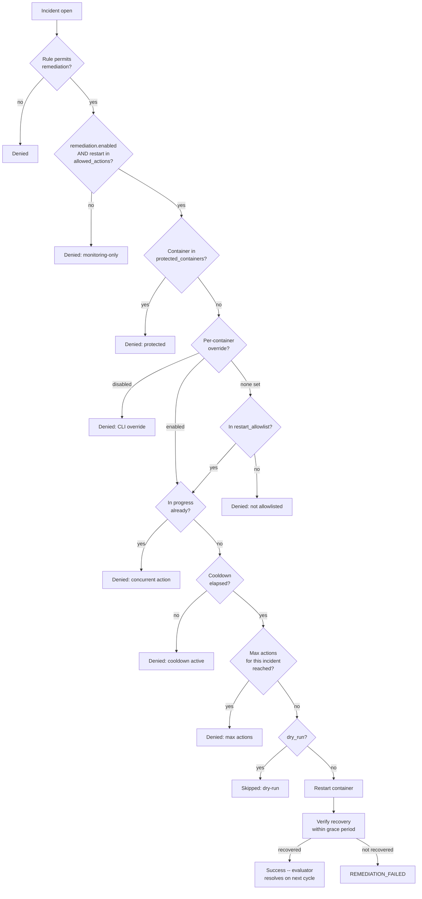

# Architecture

## Component overview

Docker Health Guardian is a single-process service built from small,
testable components with one-directional data flow. Each box below is a
Python package under `src/docker_health_guardian/`:

### Why this shape

- **Collector** is the only component that talks to the Docker SDK. It
  returns a `ContainerSnapshot` (a plain Pydantic model) for every container,
  so nothing downstream needs to know about the Docker API, `docker-py`
  object types, or how CPU/memory math works.
- **HealthEvaluator** is a pure state machine over snapshots: it holds small
  rolling-window state per container (exceeded-since timestamps, restart
  event history, a bounded sample buffer) and emits `RuleMatch` objects. It
  has no knowledge of incidents, persistence, or notifications -- this is
  what makes `tests/unit/test_evaluator.py` able to test every rule with
  synthetic timestamps and zero I/O.
- **diagnose()** is a pure function: `RuleMatch -> Diagnosis`. One
  `if/elif` dispatch table, no ML, no network calls -- see
  `docs/REMEDIATION_POLICIES.md` for why that matters for the safety story.
- **IncidentManager** owns the lifecycle and deduplication. It is the only
  component allowed to create/resolve incidents, so "is this a new problem
  or the same one continuing" has exactly one answer, computed in exactly
  one place.
- **RemediationEngine** never decides *whether a problem exists* -- that's
  the evaluator's job. It only decides whether an *already-open* incident is
  eligible for an *already-defined* action, and it is the only component
  allowed to call `collector.restart_container()`.
- **NotificationManager**, **metrics**, **reporting**, **api**, and **cli**
  are all consumers of persistence (and, for notifications, of the
  live incident object) -- none of them feed back into detection logic.

## Incident lifecycle

Not every incident visits every state -- most incidents in monitoring-only
mode (the shipped default) go straight from `INVESTIGATING` to `RESOLVED`
once the evaluator observes the condition clear, since remediation is never
attempted. `RemediationEngine` never sets a terminal `RESOLVED` state itself;
only the evaluator's next real observation does, so "fixed" always means
"actually observed to be fixed," not "we issued a restart command."

## Remediation decision flow

## Data flow per monitoring cycle

1. `Scheduler.run_once()` pings the daemon; an unreachable daemon raises its
   own `docker_daemon_unreachable` incident against the pseudo-container
   `__guardian_system__` and skips container collection for that cycle.
2. `DockerCollector.list_container_snapshots()` returns one
   `ContainerSnapshot` per container (state, health, resource stats).
3. For each snapshot, `HealthEvaluator.evaluate()` returns
   `(triggered: list[RuleMatch], cleared: list[rule_id])`.
4. Each triggered match goes through `IncidentManager.process_triggered()`
   (dedup/cooldown), then `NotificationManager.notify()` and
   `RemediationEngine.attempt_remediation()`.
5. Each cleared rule_id resolves the matching open incident via
   `IncidentManager.process_cleared()`.
6. Prometheus gauges/counters are updated; cycle duration is recorded.

This is a synchronous, single-threaded loop by design (see
`docs/REMEDIATION_POLICIES.md` for the "no overlapping cycles" safety
rationale) -- the read-only API and CLI run independently against the same
SQLite file and never block or participate in the monitoring loop itself.
